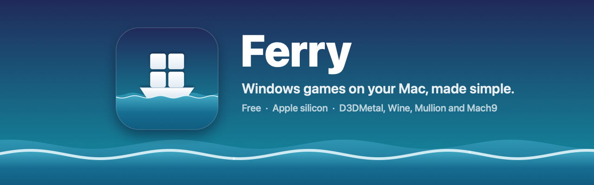
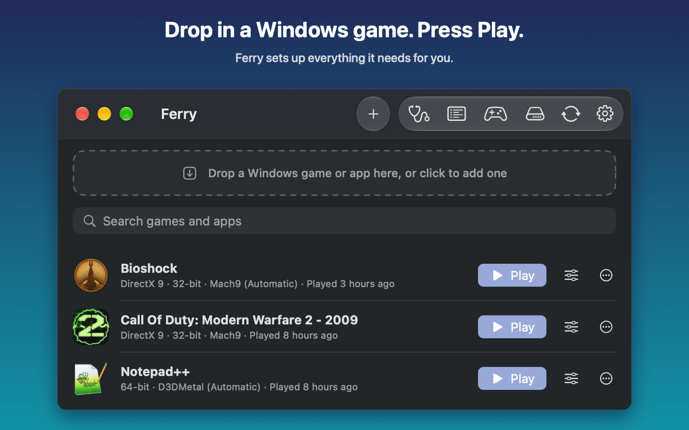

<p align="center">
  
</p>

<p align="center">
  <a href="https://github.com/rhyvo/Ferry/releases/latest"><b>⬇️ Download Ferry</b></a>
  &nbsp;·&nbsp;
  <a href="#install">Install</a>
  &nbsp;·&nbsp;
  <a href="#how-ferry-picks-an-engine">How it works</a>
  &nbsp;·&nbsp;
  <a href="#faq">FAQ</a>
  &nbsp;·&nbsp;
  <a href="https://github.com/rhyvo/Ferry/issues/new/choose">🐞 Report a bug</a>
</p>

<p align="center">
  <a href="https://github.com/rhyvo/Ferry/releases"></a>
  <a href="https://github.com/rhyvo/Ferry/stargazers"></a>
  <a href="https://www.youtube.com/@rhyvo_ferry"></a>
  <a href="https://ko-fi.com/rhyvo"></a>
</p>

<p align="center">
  
</p>

**Ferry runs Windows games and programs on Apple silicon Macs.** Drop in a game and press Play. Ferry reads the game, picks the best way to run it, installs what it needs, and gets out of the way. It's free, and it's a small native Mac app.

## Watch it run

Call of Duty: Modern Warfare 2 on the same Mac, same settings and same moment: Ferry against CrossOver.

<p align="center">
  <a href="https://www.youtube.com/watch?v=YwlEyGBTF3o"></a>
  &nbsp;
  <a href="https://www.youtube.com/shorts/4Uxhn2WzaZ4"></a>
</p>

More on the [Rhyvo YouTube channel](https://www.youtube.com/@rhyvo_ferry).

## Why Ferry

- **No setup to figure out.** No bottles, prefixes or config files. Ferry checks each game before it runs and chooses the engine and settings for you.
- **Four engines, one app.** Apple's D3DMetal, Wine Staging (with DXVK), Mullion and Mach9, each used for the games it runs best. Two of them don't need Rosetta at all.
- **Everything games need.** Visual C++, DirectX, .NET, XNA, PhysX, OpenAL and video codecs are installed once and shared by every game.
- **Kept up to date.** Engines update from their own projects with one click, D3DMetal 4 (beta) included.

## Features

- 🎮 **Drag and drop:** `.exe`, `.msi` and `.bat` files, game folders, and `.zip`, `.rar` and `.7z` archives (multi-part too). Archives are unpacked for you.
- 🩺 **Compatibility Check:** see a game's engine, graphics (DirectX, Vulkan or OpenGL), what it needs and what might block it, without running anything.
- 🧭 **Smart program picking:** for games with several programs, Ferry finds the real game, and offers single-player and multiplayer as separate entries.
- 🚂 **One-click Steam:** installs Steam for Windows, and lets you add its games to your library.
- ⚡ **Faster DirectX 9:** Ferry's own fix makes DirectX 9 games that copy the screen a lot several times faster on Apple GPUs.
- 🧩 **Mods:** install mods and remove them again cleanly, with the original files put back.
- 📊 **Task Manager:** every Windows program that's running, with memory, CPU and GPU use, and a way to end stuck ones.
- 💾 **Storage:** see what Ferry keeps on disk, and clear out old environments and leftovers in one click.
- 🎯 **Per-game settings:** engine, MetalFX upscaling, Retina, the Metal FPS HUD, ⌘ as Ctrl, FEX or Rosetta 2 for Mullion, launch arguments and more.
- 🕹️ **Controllers** for Xbox and PlayStation work automatically, and **Discord** shows what you're playing.
- 🎨 **Native and polished:** made for macOS, with Mac shortcuts for your games and a theme color you can pick.

## Install

1. [Download **Ferry**](https://github.com/rhyvo/Ferry/releases/latest) (the `.dmg` file) and open it.
2. Drag **Ferry** into **Applications**.
3. The first time you open it, macOS blocks it because it isn't from the App Store or a registered developer. Open **System Settings ▸ Privacy & Security**, scroll down, and click **Open Anyway** next to Ferry. You only need to do this once.
4. Ferry's setup screen lists what it will install. Click **Install** and let it finish. It takes a while the first time, mostly for .NET.

**Needs:** a Mac with Apple silicon (M1 or later) and macOS 14 or later. Mach9 needs macOS 26.4 or later. D3DMetal 4 needs macOS 27; on older macOS, that download uses D3DMetal 3.

## How Ferry picks an engine

Ferry reads each program without running it, to see whether it's 32- or 64-bit and which graphics it uses:

| Game | Engine | How it draws |
|---|---|---|
| 64-bit DirectX 11 / 12 | **D3DMetal** | Apple's own translator, straight to Metal |
| DirectX 9, DirectX 10, 32-bit DirectX 11, Vulkan | **Mach9** | DirectX and Vulkan straight to Metal, no Rosetta |
| OpenGL and Clickteam games | **Mullion** | DirectX and OpenGL 4.6 to Metal, no Rosetta |
| Installers and older 32-bit games | **Wine Staging** | WineD3D or DXVK |

If a game closes right after starting, Ferry shows why and offers the next engine to try. Whichever works becomes that game's setting. You can always choose an engine yourself in a game's settings.

**Rosetta:** D3DMetal and Wine Staging run game code through Rosetta. Mullion and Mach9 use FEX instead, so they keep working on a Mac without Rosetta, and Ferry switches to them automatically.

**D3DMetal 4 (beta):** install it from **Settings ▸ Components**. It's Apple's newest D3DMetal on a modern Wine 11, from MetalSharp's x86_64 build, and every D3DMetal game uses it while it's installed. Remove it in **Settings ▸ Engines** to go back.

## What can't run

- **Games with kernel anti-cheat** (Valorant, Fortnite and most competitive shooters). No Mac translation layer can run them.
- **Windows drivers**, and programs that need them.
- **16-bit programs** and **Microsoft Store packages**.

Ferry's Compatibility Check tells you about these before you add a game.

## FAQ

**Is it really free?** Yes. Ferry costs nothing, and so do all the engines and libraries it downloads.

**Do I need to know about Wine?** No. That's the point of Ferry. If you do, every engine and setting is there for you to change.

**Where are my games and saves?** Games run from wherever you keep them. Ferry's engines and Windows environments live in `~/Library/Application Support/Ferry`. Each game's saves are kept apart from its environments, so switching engines never loses them. **Back Up Saves** in a game's settings zips them to Documents.

**How do I uninstall it?** Delete `Ferry.app` from Applications, and `~/Library/Application Support/Ferry` if you want its engines and environments gone too.

**A game doesn't work. What now?** Right-click it and choose **Troubleshoot…**. Ferry reads the game's log, suggests fixes, and can try another engine.

## Building from source

You need Xcode or the Xcode Command Line Tools.

```bash
git clone https://github.com/rhyvo/Ferry.git
cd Ferry
./build.sh
```

`build.sh` compiles Ferry and copies it to `/Applications`. Use `./build.sh --no-install` to only build it into `./build`, or `./make-release.sh` to make a `.dmg`.

## Support Ferry

Ferry is free and always will be. If it got one of your games running, you can help keep it going with a tip on Ko-fi. Tips go toward testing more games, adding new engines as they come out, and an Apple Developer membership so Ferry opens without the "Open Anyway" step.

<p align="center">
  <a href="https://ko-fi.com/rhyvo"></a>
</p>

You can also open this page from Ferry's menu: **Ferry ▸ Support Ferry…**. Starring the repository and telling friends helps too.

## Credits

Ferry stands on the work of these projects, which it downloads from their own releases:

- [Wine](https://www.winehq.org): the Windows compatibility layer under every engine
- [Apple's Game Porting Toolkit](https://developer.apple.com/games/game-porting-toolkit/): D3DMetal
- [Gcenx](https://github.com/Gcenx): Game Porting Toolkit, Wine Staging and DXVK-macOS builds for Mac
- [MetalSharp Wine](https://github.com/metalsharp/MetalSharp-Wine): Mullion, and the Wine 11 build behind D3DMetal 4
- [Mach9](https://github.com/athei/mach9): mtld3d, DXMT and KosmicKrisp on an Apple-silicon Wine
- [DXVK](https://github.com/doitsujin/dxvk), [7-Zip](https://www.7-zip.org) and [cnc-ddraw](https://github.com/FunkyFr3sh/cnc-ddraw)

Ferry isn't affiliated with Apple, Microsoft, Valve or CodeWeavers. Please only run games you own.
